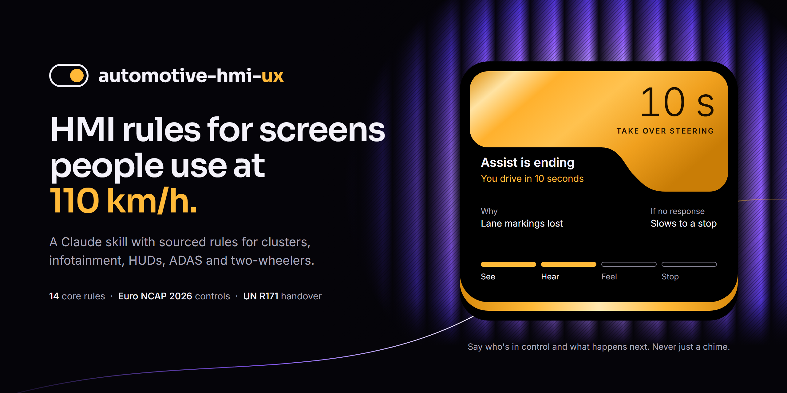

<p align="center">
  
</p>

<p align="center">
  <a href="https://github.com/Sthitapragna-009/automotive-hmi-ux/releases/latest"></a>
  <a href="LICENSE"></a>
  <a href="LICENSE-docs"></a>
  <a href="https://github.com/Sthitapragna-009/automotive-hmi-ux/stargazers"></a>
</p>

# automotive-hmi-ux

**Design rules for car, motorcycle and scooter interfaces that drivers can use without crashing, packaged as a Claude skill.**

Ask Claude to design an infotainment screen or an ADAS alert, and it usually designs a phone app on a bigger screen: deep menus, everything on the touchscreen, a chime for every warning. This skill teaches Claude the numbers regulators, rating bodies and platform owners publish (glance budgets, lockouts, required physical controls, takeover times) and what car makers learned the hard way. Every rule links its source and says what kind of evidence backs it.

**Made for** HMI and UX designers, UX writers and researchers working on instrument clusters, infotainment, HUDs, steering-wheel controls, voice assistants, driver-assistance and automation, EV apps, and two-wheeler dashboards.

## What changes in practice

| You ask for… | Typical result | With automotive-hmi-ux |
|---|---|---|
| A climate control screen | Everything on the touchscreen, three menus deep | Climate and volume on physical controls; indicators, wipers, hazards, horn and SOS physical, as Euro NCAP 2026 expects |
| A message notification | The full message on screen | Text locked while moving, read aloud on request, "Available when parked" |
| An ADAS takeover alert | A chime and a red icon | Who's in control and why, seconds left, and an escalation from visual to sound to haptic to a controlled stop |
| A speed-limit display | The limit vanishes when a sign can't be read | The last known limit stays, with a plain "Couldn't read sign" state |
| A scooter dashboard | A phone-style touchscreen | One glove-friendly input, a minimal glance mode and automatic day/night |

These are examples of the rules in the skill, not recorded outputs. Try them yourself with the [prompt gallery](docs/prompts.md).

## Get started

### Option 1: Claude.ai or the Claude desktop app (no code)

1. Download **[automotive-hmi.zip](https://github.com/Sthitapragna-009/automotive-hmi-ux/releases/latest/download/automotive-hmi.zip)**.
2. In Claude, open **Settings → Capabilities → Skills** and upload the zip as it is. Don't unzip it.
3. Start a new chat and ask: *"Design the ADAS takeover request for an L2 car, from first cue to escalation."*

### Option 2: Claude Code

Type these in Claude Code (they're Claude Code commands, not terminal commands):

```text
/plugin marketplace add Sthitapragna-009/automotive-hmi-ux
/plugin install automotive-hmi-ux@automotive-hmi-ux
```

## Prompts to try

- *"Audit this infotainment screen against the 2-second glance rule and Euro NCAP 2026."*
- *"Design every automation state for a hands-free highway assistant, in the cluster and the HUD."*
- *"Design a scooter dashboard that's readable in direct sunlight and works with gloves."*
- *"How should an in-car voice assistant confirm an action that changes how the car drives?"*

For better answers, tell Claude the **vehicle and market**, the **surface** (cluster, centre screen, HUD, phone projection, two-wheeler TFT), the **driving state** (parked, driving, automation level) and **what you want back**. More in the [prompt gallery](docs/prompts.md).

## What's inside

| Reference | Covers |
|---|---|
| `distraction-and-glance.md` | NHTSA glance and occlusion budgets, lockouts, display angles, Euro NCAP 2026 physical controls, Android for Cars and CarPlay limits, buttons-vs-touchscreen benchmark data |
| `automation-and-handover.md` | SAE levels, UN R171 and R157, IIHS safeguards, driver monitoring, mode display, escalation, takeover times, lessons from the Tesla Autopilot recall |
| `clusters-hud-and-visual.md` | Cluster layout, tell-tale colours, speed and limit display, typography, night palettes, HUDs, zero-layer surfacing, haptics |
| `assistants-ev-ota.md` | Voice and LLM assistants, EV range, charging and regen, over-the-air updates, companion phone apps |
| `two-wheelers.md` | Motorcycle and scooter dashboards, glove input, navigation, safety features |
| `case-studies.md` | What Tesla, Volkswagen, Hyundai, BMW, Mercedes-Benz, Polestar, CarPlay, Royal Enfield and Ather did, and the rule each teaches |

## The rules that matter most

1. Glances of 2 seconds or less; a whole task in 12 seconds or less.
2. One hand, interruptible at any moment, resumable where the driver left off.
3. Lock video, scrolling text and typing while moving. Read aloud instead.
4. Put the display within 30° below the driver's line of sight.
5. Physical controls for indicators, wipers, hazards, horn and SOS. Keep climate and volume physical where possible.
6. Frequent tasks in three taps or fewer; driving text in one to three short lines.
7. Benchmark every touchscreen task against physical buttons.
8. The automation mode is impossible to miss, and simple to switch on and off.
9. Watch eyes and head, not just hands on the wheel, and escalate step by step.
10. Plan handovers for the slowest driver, not the average one.
11. Never blank a safety value. Show the last known value and say when it's unknown.
12. Put key functions at the top level; accept or dismiss suggestions in one tap.
13. One typeface, a restricted palette, and colour reserved for status.
14. Two-wheelers: one glove-friendly input, a minimal glance mode, automatic day/night.

## How rules are sourced

Every rule carries one of these tags, so you know how much weight it can bear:

| Tag | Meaning |
|---|---|
| `[REG]` | Law or regulation |
| `[STD]` | Standard, rating protocol or platform guideline |
| `[RES]` | Published research |
| `[PRAC]` | Documented company practice |
| `[INF]` | Our inference from the sources |

Several standards behind the rules (ISO 15005, 15008, 16951 and 2575, SAE J2364 and J3016) are paywalled and weren't read for this repo. Where the skill relies on them, it says "not verified". Each reference file ends with an honest list of what isn't researched yet.

## Help make it better

- **Spotted a wrong or outdated rule?** [Report it](https://github.com/Sthitapragna-009/automotive-hmi-ux/issues/new?template=fix-a-rule.yml).
- **Know a study, regulation or OEM case we're missing?** [Suggest it](https://github.com/Sthitapragna-009/automotive-hmi-ux/issues/new?template=suggest-a-rule.yml). The most wanted gaps are in [CONTRIBUTING.md](CONTRIBUTING.md).
- **Found it useful?** A ⭐ helps other HMI designers find it.

## Related

- [criticalUX](https://github.com/Sthitapragna-009/Critical_UX): the same approach for fintech, healthcare, civic services and control rooms. This skill started there.
- [liqUI9](https://github.com/Sthitapragna-009/liqUI9): Liquid Glass and Apple HIG as Claude skills.

## Credits and licence

Created by **[KSP](https://kspportfolio-one.vercel.app)**.

- Code (workflows, banner source, code samples): [MIT](LICENSE)
- Written guidance (skill, references, docs): [CC BY 4.0](LICENSE-docs)

automotive-hmi-ux is an independent community project and design guidance. It is not legal, homologation, functional-safety or engineering advice, and it is not a substitute for the standards and regulations it summarises. See [NOTICE.md](NOTICE.md) for trademarks and sources.
